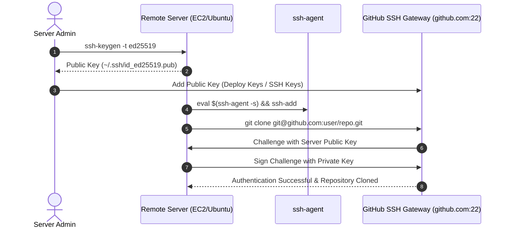

# How to Clone GitHub Private Repositories on Remote Servers

<div align="center">

[](https://github.com/codewithmuh/clone-private-repo/releases)
[](https://opensource.org/licenses/MIT)
[](https://github.com/codewithmuh/clone-private-repo/stargazers)
[](https://github.com/codewithmuh/clone-private-repo/network/members)
[](https://git-scm.com/)
[](https://www.openssh.com/)
[](https://github.com/)
[](https://youtu.be/kgrWQ2xV_Gc)

**The definitive production guide to cloning private GitHub repositories on cloud servers (AWS EC2, GCP, Ubuntu) using secure Ed25519 SSH keys and repository Deploy Keys.**

[Overview](#overview) • [Authentication Architecture](#authentication-flow) • [Comparison Table](#authentication-methods-comparison) • [Step-by-Step Guide](#step-by-step-setup) • [Deploy Keys for CI/CD](#best-practice-repository-deploy-keys) • [Troubleshooting](#troubleshooting--faq)

</div>

---

## Overview

When deploying software to remote production virtual machines (AWS EC2, DigitalOcean droplets, Hetzner, or GCE), authenticating with your personal GitHub account password is no longer supported and personal access tokens risk leaking broad permissions.

This guide provides secure, industry-standard methods to clone private repositories using **Ed25519 SSH keypairs** and **Repository Deploy Keys** with principle of least privilege.

🎥 **Watch the full step-by-step video breakdown on [YouTube](https://youtu.be/kgrWQ2xV_Gc).**

---

## Authentication Flow



---

## Authentication Methods Comparison

| Method | Security Scope | Recommended Use Case | Blast Radius if Server Compromised |
|---|:---:|---|:---:|
| **Deploy Key (Read-Only)** | Single Repository | **Production Web & Cloud Servers** | **Zero (Only this specific repo)** |
| **Deploy Key (Read/Write)**| Single Repository | Automated CI/CD Tagging / Bots | Moderate (Single repo write access) |
| **User SSH Key** | All User Repositories | Personal Development Workstation | High (Full access to all user repos) |
| **Fine-Grained PAT** | Select Repos + Scopes | Ephemeral Docker / Build Automation | Limited by token expiration date |

---

## Step-by-Step Setup

### Step 1: Generate a Modern Ed25519 SSH Keypair
On your remote server, generate a high-security Ed25519 keypair:

```bash
ssh-keygen -t ed25519 -C "server-deploy-key"
# Press Enter to save in default location (~/.ssh/id_ed25519)
# Press Enter for empty passphrase (recommended for non-interactive servers)
```

### Step 2: Start SSH Agent and Register Private Key
```bash
eval "$(ssh-agent -s)"
ssh-add ~/.ssh/id_ed25519
```

### Step 3: Copy Your Public Key
Print the generated public key to your terminal:

```bash
cat ~/.ssh/id_ed25519.pub
```
*Copy the entire output line beginning with `ssh-ed25519 ...`.*

### Step 4: Add Key to GitHub

#### Option A: Repository Deploy Key (Recommended for Cloud Servers)
1. In your GitHub repository, navigate to **Settings** > **Deploy keys**.
2. Click **Add deploy key**.
3. Set Title: `EC2-Production-Server`.
4. Paste the public key string into the **Key** field.
5. Leave "Allow write access" unchecked for secure read-only pulling.

#### Option B: User Account SSH Key (Recommended for Personal Dev Servers)
1. Go to GitHub **Settings** > **SSH and GPG keys**.
2. Click **New SSH key**, paste your key, and save.

### Step 5: Test SSH Connection
Verify that GitHub recognizes your key:

```bash
ssh -T git@github.com
```
*Expected output:*
> `Hi username! You've successfully authenticated, but GitHub does not provide shell access.`

### Step 6: Clone Your Private Repository
Clone using the SSH URI format (`git@github.com:...`):

```bash
git clone git@github.com:YOUR_USERNAME/YOUR_PRIVATE_REPO.git
```

---

## Updating Existing Clones from HTTPS to SSH

If your local server already has the repository configured with HTTPS, switch it to SSH:

```bash
cd /path/to/your-repo
git remote set-url origin git@github.com:YOUR_USERNAME/YOUR_PRIVATE_REPO.git
git remote -v
git pull origin main
```

---

## Troubleshooting & FAQ

### `Permission denied (publickey)`
1. Ensure the key is registered with the agent: `ssh-add -l`
2. Test connection with debug verbose flags: `ssh -vT git@github.com`
3. Verify file permissions on your server:
   ```bash
   chmod 700 ~/.ssh
   chmod 600 ~/.ssh/id_ed25519
   chmod 644 ~/.ssh/id_ed25519.pub
   ```

### `Host key verification failed`
Add GitHub's official SSH host keys to your `known_hosts` file:
```bash
ssh-keyscan -t ed25519 github.com >> ~/.ssh/known_hosts
```

---

## Community & Resources

- 🎥 **YouTube Tutorial:** [Step-by-Step Video Guide](https://youtu.be/kgrWQ2xV_Gc)
- 🌐 **DevOps Resources Hub:** [devops-training-resources](https://github.com/codewithmuh/devops-training-resources)
- 👤 **Follow on LinkedIn:** [Muhammad Rashid](https://www.linkedin.com/in/codewithmuh)

---

## License

This project is licensed under the [MIT License](LICENSE).
